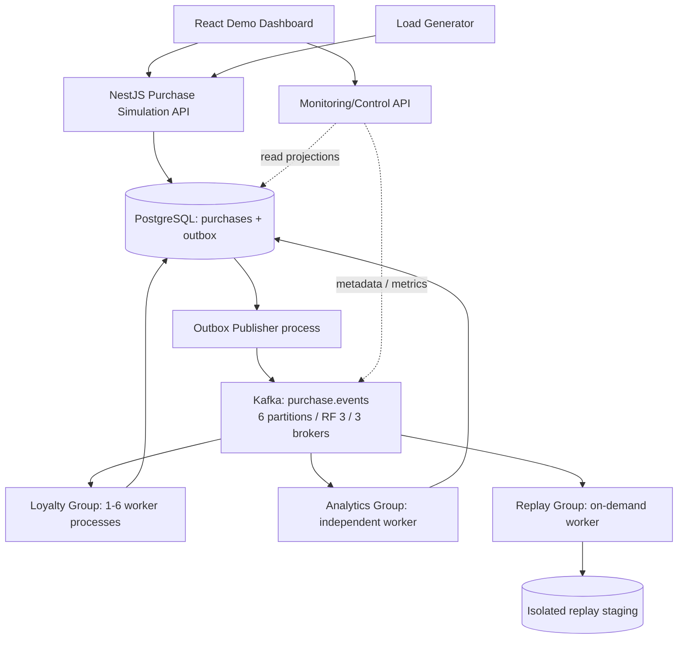
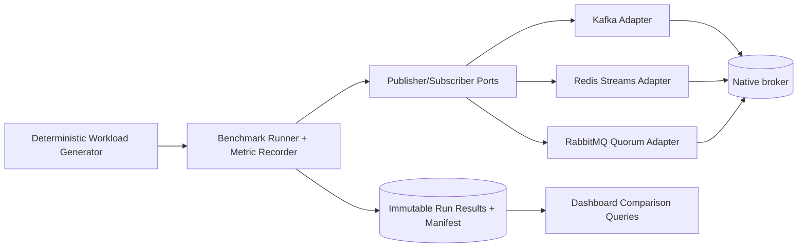

# 01 — System Architecture and Boundaries

## Principle

The end-state architecture is a **distributed event-streaming laboratory** with a simulated workload, **not** microservices deployed merely for their own sake. Independent processes exist where they demonstrate Kafka consumer-group independence, scaling, or crash recovery.

## End-state data flow



Kafka internal replication (leader/follower/ISR) occurs **inside** the Kafka cluster and must not be confused with duplicating consumer groups. The publisher writes to the leader for a key's partition; followers replicate broker logs. Kafka brokers expose internal offsets and group metadata. Consumers read through their partition leaders, generally against group-assigned partitions.

## Minimal architecture by stage

- **Phases 1–3:** API → **direct** Kafka producer → broker → independent worker(s). No PostgreSQL or Outbox yet. Store temporary consumer calculation in memory **only to explain** concepts; never claim crash-safety.
- **Phase 4 onward:** API writes Purchase+Outbox in PostgreSQL; independent publisher → Kafka → workers using DB transactions and manual offsets.
- **Phase 5:** replay group reads retained Kafka history and builds isolated staging output; optional controlled cutover.
- **Phase 6:** workers are separately containerized and can scale in the same `groupId`.
- **Phase 7:** separate three-broker KRaft Compose profile, new cluster/topic with RF=3; run leader-failover experiments.
- **Phase 8:** instrument real throughput/latency/resource metrics and build a repeatable **Kafka-only baseline**; the dashboard consolidates measured Kafka state.
- **Phase 9:** introduce the **independent Streaming Benchmark bounded context** and Redis Streams / RabbitMQ Quorum Queue adapters. RabbitMQ native Streams/Super Streams is a separate optional adapter.
- **Phase 10:** integrate comparison charts, reports and seminar runbook after benchmark integrity tests pass.

A single end-state picture **must not** lead the coding agent to build Phase 7 before Phase 1 works.

## Bounded contexts and ownership

| Context | Owns | Does not own |
|---|---|---|
| Purchase Simulation | Accept event requests, enforce customer sequence, persist synthetic purchases, write outbox | Calculate loyalty; consumer offsets |
| Loyalty | Calculate deterministic points/tier, persist loyalty state, detect duplicate events | Purchase lifecycle/source of truth; Kafka administration |
| Sales Analytics | Independently project purchase counts/revenue | Loyalty rules; purchase writes |
| Streaming Operations | Start demo scenarios, inspect Kafka metadata/metrics, controlled worker/broker operations | Business rules; consumer DB mutations |
| Shared integration contract | Versioned event envelope and validation | Domain aggregates or application services |
| Streaming Benchmark (Phase 9) | Deterministic corpus, common throughput/latency metrics, trial manifests, adapter ports and comparative reports | Purchase/Loyalty domain, Kafka cluster administration, assumptions of identical broker capabilities |

## Proposed monorepo (target layout)

```text
.
├── AGENTS.md
├── README.md
├── apps/
│   ├── producer-api/src/
│   │   ├── purchases/
│   │   │   ├── domain/
│   │   │   ├── application/{commands,queries,ports}/
│   │   │   ├── infrastructure/{persistence,messaging}/
│   │   │   └── interfaces/http/
│   │   └── main.ts
│   ├── outbox-publisher/src/
│   ├── loyalty-worker/src/
│   │   ├── domain/
│   │   ├── application/{commands,queries,ports}/
│   │   ├── infrastructure/{persistence,messaging}/
│   │   └── main.ts
│   ├── analytics-worker/src/
│   ├── replay-worker/src/
│   ├── monitoring-api/src/
│   ├── dashboard/src/features/{events,partitions,consumers,replay,faults}/
│   ├── load-generator/src/
│   └── benchmark-runner/src/    # Phase 9: isolated transport-only comparison
├── packages/
│   ├── contracts/src/           # Integration event schemas/types only
│   ├── kafka-client/src/        # Thin KafkaJS adapters/utilities
│   ├── observability/src/       # Typed logger/metrics primitives
│   ├── benchmark-core/src/      # Phase 9 benchmark ports, metrics, corpus
│   ├── broker-kafka/src/        # Phase 9 benchmark adapter (not domain layer)
│   ├── broker-redis-streams/src/ # Phase 9 only
│   ├── broker-rabbitmq-quorum/src/ # Phase 9 only
│   └── test-fixtures/src/       # Synthetic, deterministic fixtures
├── infra/
│   ├── compose/
│   ├── kafka/{topics,scripts}/
│   ├── postgres/migrations/
│   └── scripts/
└── docs/
```

**Do not create all folders on Day 1.** Create a folder when there is implemented responsibility; show evolution in git history. Prefer context-first structure to `controllers/ services/ entities/` spanning the entire repository.

## Dependency direction

```text
interfaces/http or interfaces/kafka (inbound adapters)
                     |
                     v
              application use case
                     |
                     v
             domain + ports
                     ^
                     |
          infrastructure adapters
           (Postgres, KafkaJS)
```

**Allowed:** an application use case can depend on a repository interface and a unit-of-work abstraction.  
**Forbidden:** `loyalty/domain` importing `kafkajs`, `@nestjs/common`, `pg`, env vars, Express responses, or React; HTTP controller writing SQL; Kafka adapter calculating tier.

## Runtime deployment rules

- Producer API, publisher, each Loyalty worker, Analytics and Replay are separately startable processes from their respective entrypoints.
- Initially a single process per role is enough; independent scaling/kill in Phase 6 is mandatory.
- Shared Postgres instance is acceptable for a local seminar; separate schemas/table ownership by context prevent accidental cross-context mutations.
- The dashboard accesses monitoring API and query/read endpoints, **never Kafka directly**.
- A monitor may query Kafka Admin API, consumer instrumentations, and JMX/CLI metrics; there must be an explicit distinction between *measured broker metrics* and *application processing metrics*.
- Fault injection uses developer CLI/Compose scripts first. If UI controls are added, they call strictly allowlisted operations in a **local-only** control plane.

## Synchronous vs asynchronous contract

Phase 4 onward, `POST /demo/purchases` commits a synthetic purchase and outbox record. It need **not** block until Loyalty/Analytics completes. Statuses: `ACCEPTED` (source committed), `PUBLISH_PENDING|PUBLISHED|FAILED_RETRYABLE`, `LOYALTY_PENDING|PROCESSED`. The API should not falsely claim consumers completed.

## Failure boundaries

| Failure | Expected boundary |
|---|---|
| Producer API process stops after commit | Persisted outbox eventually publishes on restart. |
| Outbox Publisher loses connection | Outbox stays retryable; no lost source purchase. |
| Loyalty process dies | Kafka group redistributes partitions; DB effects gated by event ID. |
| Broker 1 fails in RF3 profile | Remaining ISR replica can lead after election; producer retries metadata/requests. |
| Entire Docker host fails | Local lab stops; no cross-machine HA claim. |
| Postgres fails | Stateful consumers cannot commit business updates; offsets must not advance. |

See `03-kafka-design.md`, `05-persistence-and-reliability.md`, and `10-kraft-replication.md` for mechanism-level rules.

## Benchmark architecture — isolated extension, not domain replacement



This diagram illustrates **alternative runs**, not simultaneous publishing into the same broker. The Benchmark Runner is a separate bounded context. Transport adapters implement native routing, confirmation, ACK, replay and inspection semantics; shared code owns only metrics and workload. No Kafka-specific operational method is forced onto Redis/RabbitMQ adapters. The dashboard reads saved results and live Kafka metrics, never fabricating cross-broker equivalence. See `13-broker-ports-and-adapters.md` and `14-benchmark-methodology-and-metrics.md`.
