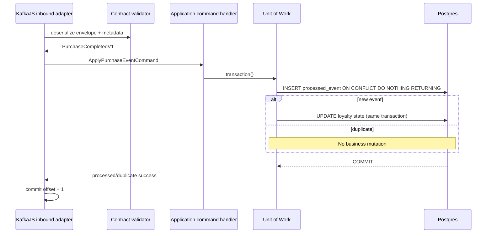

# 02 — DDD, Clean Architecture, CQRS and Separation of Concerns

## Design objective

Employ DDD/CQRS **where it creates clarity**. The domain stays intentionally tiny because Kafka mechanics are the main subject. Favor explicit domain invariants and testable use cases over factory-heavy or ceremony-heavy enterprise patterns.

## Bounded contexts

### Purchase Simulation

- **Aggregate root:** `SyntheticPurchase` only if lifecycle constraints are present; otherwise a small domain entity plus `PurchaseFactory` is sufficient.
- **Invariants:** positive integer cents, unique purchase ID, immutable customer ID/amount once accepted, only completed purchase can transition to invalidated, invalidation is idempotent.
- **Ordering:** per-customer monotonic event sequence established under transactional lock from Phase 4.
- **Domain events:** `PurchaseCompletedDomainEvent`, `PurchaseInvalidatedDomainEvent` (local in-memory domain concepts).
- **Integration events:** externally versioned `PurchaseCompletedV1`, `PurchaseInvalidatedV1`, mapped from persisted domain state at infrastructure boundary. Do not serialize domain objects directly.

### Loyalty

- **Aggregate root:** `LoyaltyAccount` (customer ID, eligible cumulative spend, points, tier, last applied customer sequence).
- **Pure operations:** `applyCompletedPurchase()` evaluates the previous tier and updates points/spend/tier deterministically.
- **Invariants:** no negative cents, sequential customer events, no duplicate mutation, tier derived from eligible spend.
- **Invalidation:** Phase 5 marks a pending correction/rebuild; no naive direct subtraction from a state where later purchases depended on prior tier.
- **No** reward redemption, email, wallet or money transfer logic.

### Sales Analytics

- Query-optimized aggregate/read model for counts and revenue. It need not be a rich DDD aggregate. It consumes the same events using a different Kafka `groupId` and an independent processed-event namespace.

### Streaming Operations

- Infrastructure orchestration and telemetry, not a domain bounded context that owns purchasing rules. Operations commands (pause, resume, scale, restart) require local safeguards and traceable results.

## Domain policy (pure functions / entity methods)

```ts
export type Tier = 'BRONZE' | 'SILVER' | 'GOLD';

export function tierForEligibleSpend(totalCents: number): Tier {
  if (!Number.isSafeInteger(totalCents) || totalCents < 0) {
    throw new Error('Invalid eligible spend');
  }
  if (totalCents >= 30_000) return 'GOLD';
  if (totalCents >= 10_000) return 'SILVER';
  return 'BRONZE';
}

export function pointsForPurchase(amountCents: number, tier: Tier): number {
  if (!Number.isSafeInteger(amountCents) || amountCents <= 0) {
    throw new Error('Invalid purchase amount');
  }
  const multiplier = { BRONZE: 1, SILVER: 2, GOLD: 3 }[tier];
  return Math.floor(amountCents / 1_000) * multiplier;
}
```

This is illustrative, not a requirement to reproduce these exact file contents. Money in integer cents avoids floating point rounding in the demo. `LoyaltyAccount.apply()` calculates points from *current tier*, then increments spend, then recomputes the tier.

## CQRS: command side and query side

Use NestJS `@nestjs/cqrs` in HTTP-facing composition where useful; keep command/query DTOs framework-independent where possible.

| Command | Handler | Side effects |
|---|---|---|
| `CreateSyntheticPurchaseCommand` | `CreateSyntheticPurchaseHandler` | From Phase 4: transactionally save purchase + outbox. |
| `InvalidateSyntheticPurchaseCommand` | `InvalidateSyntheticPurchaseHandler` | Transition purchase and save outbox event once. |
| `ApplyPurchaseEventCommand` | `ApplyPurchaseEventHandler` | Loyalty DB transaction and processed ID. |
| `ApplySalesEventCommand` | `ApplySalesEventHandler` | Analytics DB transaction and processed ID. |
| `StartReplayCommand` | `StartReplayHandler` | Initiate isolated replay run; bounded state. |

| Query | Handler | Source |
|---|---|---|
| `GetPurchaseQuery` | `GetPurchaseHandler` | Purchase read repository. |
| `GetLoyaltyAccountQuery` | `GetLoyaltyAccountHandler` | Loyalty projection/read model. |
| `GetSalesSummaryQuery` | `GetSalesSummaryHandler` | Analytics projection. |
| `GetKafkaGroupStateQuery` | `GetKafkaGroupStateHandler` | Monitoring adapter. |
| `GetReplayRunQuery` | `GetReplayRunHandler` | Replay progress/read model. |

**Rules:** queries are read-only; commands express intent and can mutate. A controller sends commands/queries rather than operating repositories. A Kafka consumer translates an integration event to a **local command**; the command handler owns transactional state transition. Never abuse in-memory NestJS `EventBus` as a durable message queue.

## Use-case ports (examples)

```ts
export interface PurchaseRepository {
  saveNew(purchase: SyntheticPurchase, tx: DbTransaction): Promise<void>;
  findById(id: string, tx?: DbTransaction): Promise<SyntheticPurchase | null>;
}

export interface OutboxRepository {
  append(event: OutboxEntry, tx: DbTransaction): Promise<void>;
}

export interface UnitOfWork {
  transaction<T>(work: (tx: DbTransaction) => Promise<T>): Promise<T>;
}
```

`DbTransaction` should be an opaque application-level handle rather than an imported `pg.PoolClient` type. If this abstraction is more complicated than the app needs, use a small `PurchaseUnitOfWork` port exposing a single atomic method, but **never** move DB transaction management into the controller or domain.

## Adapter responsibilities

**Inbound HTTP adapter**: deserialize, request validation, HTTP idempotency header, map request to command/query, translate domain errors to status codes.  
**Inbound Kafka adapter**: deserialize+validate integration event, attach broker metadata, call command handler, commit offset **only after success**, manage retry/pause/shutdown.  
**Infrastructure persistence adapter**: parameterized SQL, transactions, locks, uniqueness constraints, mapping SQL rows to domain.  
**Outbound Kafka adapter**: versioned serialization, producer retries/acks, broker metadata, instrumentation.

## Recommended design practices

- One reason to change per class/module. No mega `KafkaService` that also accesses every business table.
- Structured error types: validation, duplicate, sequence gap, transient database, Kafka transient, permanent incompatibility.
- Code to narrow interfaces. Provide mocks/fakes in unit tests; run true adapters in integration tests.
- Domain must not read wall-clock time or generate random IDs; inject `Clock`/`IdGenerator` at use-case level.
- Keep events immutable. Integration schemas versioned and validated on consumption.
- No use of `Date.now()` to determine business order; use assigned `customerSequence`.
- Do not call a Query Handler to mutate. Do not mutate multiple bounded contexts inside one command handler.
- CQRS means separating operations, not necessarily separate physical databases or a full event sourcing system.

## Example sequence for a Kafka consumer



**No database commit, no offset commit.** A duplicate recognized in a successful DB transaction **can** commit the corresponding Kafka offset.

## Streaming Benchmark context (added by instructor request)

The comparative benchmark is its **own bounded context**. `WorkloadSpec`, `BenchmarkRun`, `RunManifest` and `MetricWindow` are its application/measurement model; they are **not** Purchase or Loyalty aggregates. Application commands: `StartBenchmarkRun`, `CancelBenchmarkRun`; queries: `GetBenchmarkRun`, `ListBenchmarkResults`, `CompareCompatibleRuns`. Ports: `BenchmarkPublisher`, `BenchmarkSubscriber`, `MetricsRecorder`, `BenchmarkRunRepository`, `ResourceSampler`. Adapters: KafkaJS, Redis Streams client, RabbitMQ client, JSON/CSV exporter and infrastructure metrics collector. Create these only in Phase 9, when a Kafka baseline and proof harness exist.

The same deterministic event bytes, percentile formulas and result schema must run on each adapter. Broker-specific durability, partitioning, offset/ACK or replay mechanics must **not** be made generic domain operations. Details: `13-broker-ports-and-adapters.md`.
