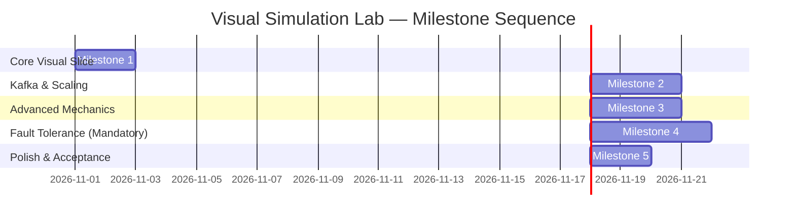

# Milestone Architecture & Implementation Plan: Visual Simulation Lab

> **Document Status**: Approved Plan & Architectural Specification  
> **Target Package**: `apps/demo-ui` (`apps/demo-ui/src/simulation/`)  
> **Reference Spec**: [new-lab.md](file:///e:/SOA-Seminar-Kafka/kafka-streaming-agent-spec/docs/new-lab.md)  
> **Isolation Contract**: 100% Client-Side. Zero communication with real Kafka brokers, Docker containers, or NestJS backend APIs.

---

## 1. Executive Summary & Core Mission

The Visual Simulation Lab is an interactive, browser-based distributed systems playground built specifically for educational visualization of Apache Kafka mechanics and event-driven architectures.

While the existing **Interactive Topology Studio** remains connected to live KRaft brokers and PostgreSQL databases, the **Simulation Lab** operates completely offline in the user's browser, powered by a deterministic, headless Discrete-Event Simulation (DES) engine.

### Key Architectural Tenets
1. **Hybrid Educational Fidelity**: Accurate Kafka distributed state machine (partitions, append-only logs, consumer group rebalances, partition ownership, offsets, lag, multi-broker replica distribution, ISR tracking, leader election, and broker failover) visualized with smooth, synchronized packet animations.
2. **Zero Infrastructure Dependency**: Functions completely without backend workers, Docker, or external network connectivity.
3. **Strict Bounded Context Isolation**: Complete isolation from existing real lab code (`TopologyCanvas.tsx`, `api/client.ts`, etc.).
4. **Extensible Component Registry**: Unified Kafka Cluster/Broker, Producer, Consumer, Worker/Service, and PostgreSQL Database in initial scope, designed to seamlessly accept future components (Redis Cache, Load Balancer, API Gateway).

---

## 2. Component Model & Kafka Topology Representation

```
┌────────────────────────────────────────────────────────────────────────────────────────────────┐
│                                 CANVAS ARCHITECTURAL TOPOLOGY                                  │
│                                                                                                │
│  ┌───────────────────────┐            ┌──────────────────────────────────────────────┐         │
│  │      🚀 Producer      │            │          📦 Kafka Cluster / Broker           │         │
│  │  rate: 2 msg/s        │──(publish)─▶  Brokers: 3 (B1, B2*, B3)                    │         │
│  │  key: "U001"          │            │  Topic: "purchases" (Partitions: 4, RF: 3)   │         │
│  └───────────────────────┘            │  • P0: Leader B1 | ISR [B1,B2,B3] | LEO: 42  │         │
│                                       │  • P1: Leader B2 | ISR [B2,B3]    | LEO: 39  │         │
│                                       │  • P2: Leader B3 | ISR [B1,B3]    | LEO: 45  │         │
│                                       │  • P3: Leader B1 | ISR [B1,B2]    | LEO: 40  │         │
│                                       └──────────────────────┬───────────────────────┘         │
│                                                              │ (poll / dispatch)               │
│                                       ┌──────────────────────┴───────────────────────┐         │
│                                       │                                              │         │
│                                       ▼                                              ▼         │
│                         ┌───────────────────────────┐                  ┌─────────────────────┐ │
│                         │   👥 Consumer Instance 1  │                  │ 👥 Consumer Inst 2  │ │
│                         │   Group: "loyalty-v1"     │                  │ Group: "loyalty-v1" │ │
│                         │   Assigned: [P0, P1]      │                  │ Assigned: [P2, P3]  │ │
│                         │   Delay: 100ms            │                  │ Delay: 100ms        │ │
│                         └─────────────┬─────────────┘                  └──────────┬──────────┘ │
│                                       │ (handler write)                           │            │
│                                       └──────────────────────┬────────────────────┘            │
│                                                              ▼                                 │
│                                               ┌──────────────────────────────┐                 │
│                                               │    🗄️ PostgreSQL Database    │                 │
│                                               │    Tables: loyalty_accounts  │                 │
│                                               │    Write Latency: 15ms       │                 │
│                                               └──────────────────────────────┘                 │
└────────────────────────────────────────────────────────────────────────────────────────────────┘
```

### 2.1 Unified Kafka Cluster / Broker Component
The UI represents Kafka on the canvas as a **Unified Kafka Cluster / Broker** component, while the underlying domain model strictly separates **Brokers**, **Topics**, **Partitions**, and **Replicas**:

- **Canvas Card Presentation**:
  - Cluster Title & ID (`Kafka Cluster: kraft-sim`).
  - Active Broker Nodes (`Broker 1 (Controller)`, `Broker 2`, `Broker 3`).
  - Broker Health Status Pills (`ONLINE`, `FAILED/CRASHED`).
  - Managed Topics Summary (e.g., `purchases (4P, RF:3)`).
- **Inspector Expanded View**:
  - **Topic Manager**: Add/configure topics, set partition counts and replication factors.
  - **Partition Strip & Replica Grid**: Displays partition leaders, follower replicas, and ISR status per broker.
  - **Append-Only Log Tape**: Visual segmented record tape per partition `[Offset 0 | 1 | 2 | 3 | ...]`.
  - **Broker Control Panel**: Individual broker kill/crash, network delay, and recovery buttons.

### 2.2 Core Component Registry Schema
Every node on the canvas adheres to a strict registry schema defining ports, config schemas, and operational handlers:

| Component Type | Inbound Port Semantics | Outbound Port Semantics | Configurable Properties | Runtime Handlers |
| :--- | :--- | :--- | :--- | :--- |
| **`producer`** | None (Source node) | `publish` (Connects to Kafka Cluster) | Message rate, Key strategy (Murmur2), Payload template, Client latency, `acks` (`0`, `1`, `all`) | Synthetic record generator, partition selector |
| **`kafka-cluster`** | `publish` (From Producer) | `dispatch` (To Consumer instances) | Broker list, Topic definitions, Partition counts, Replication factors, `min.insync.replicas` | Append-only partition logs, replica fetchers, group coordinator rebalances |
| **`consumer`** | `dispatch` (From Kafka Cluster) | `handler-action` (To Database / Worker) | `groupId`, Processing latency (ms), Concurrency slots, Failure rate %, Commit mode (`auto`, `manual`) | Partition poll queue, ordered record processor, offset committer |
| **`worker-service`** | `invoke` / `dispatch` | `handler-action` | Service name, Processing delay, Error rate | Business calculation, downstream dispatch |
| **`database`** | `handler-action` (From Consumer / Service) | None (Sink node) | DB Engine (`PostgreSQL`), Write delay (ms), Pool capacity, Schema tables | Append-only projection tables, write acknowledgment |

---

## 3. Kafka Mechanics & Offset Semantics

### 3.1 Correct Offset & Lag Definitions
The simulation model adheres strictly to official Kafka semantics, completely eliminating any conflation between `logEndOffset` and `highWatermark`:

- **`logStartOffset`**: The earliest valid offset in a partition log (defaults to `0`).
- **`logEndOffset` (LEO)**: The offset of the next record to be appended to the partition log on a specific replica.
- **`highWatermark` (HWM)**: The highest offset that has been replicated to all active members of the In-Sync Replica (ISR) set. Consumers can only read records up to the `highWatermark`.
- **`committedNextOffset`**: The next offset that a specific consumer group will read upon restarting or polling.
- **`consumerLag`**: Calculated strictly per topic-partition-group:
  $$\text{Lag}_{(g, t, p)} = \text{logEndOffset}_{(t, p)} - \text{committedNextOffset}_{(g, t, p)}$$

### 3.2 Partition Ordering & Consumer Concurrency Invariant
- **Strict Single-Partition Ordering**: A partition is an ordered append-only queue. Records within partition $P$ must be processed strictly in offset order $O, O+1, O+2$.
- **Concurrency Slot Model**: If a consumer is configured with concurrency slots $S > 1$, concurrency is allowed **only across distinct partitions**. A single partition $P$ will never have multiple in-flight concurrent execution slots out-of-order.

---

## 4. Consumer Scaling, Rebalance & Duplication

### 4.1 Rebalance Protocol & Partition Assignment
When a consumer instance is added or removed from a consumer group:
1. **Trigger Event**: A `REBALANCE_TRIGGERED` event is scheduled on the simulation timeline.
2. **Rebalance Phase**:
   - Consumer polling is briefly suspended for the modeled rebalance duration (e.g., 150ms virtual time).
   - The coordinator executes partition assignment using the configured strategy:
     - **Range Assignor**: Cohesive partition ranges assigned per topic.
     - **Round-Robin Assignor**: Partitions distributed evenly across group members.
3. **Partition Ownership Rule**:
   - A partition can belong to **at most one** active member of a given consumer group at any instant.
   - If `consumerCount > partitionCount`: The surplus consumers transition to the **`IDLE`** state (no assigned partitions).
4. **Group Isolation**:
   - Multiple consumer groups (`loyalty-v1` and `analytics-v1`) maintain completely independent partition assignments and independent `committedNextOffset` trackers.

### 4.2 Context-Aware Node Duplication
When the user clicks `Duplicate` on a Consumer:
- **Instance ID**: Generates a unique ID (e.g., `consumer-2`).
- **Configuration Copy**: Clones processing latency, commit mode, and failure rates.
- **Group Preservation**: Retains the same `groupId` by default.
- **Connection Wiring**:
  - Automatically replicates the inbound wire from the Kafka Cluster.
  - Automatically replicates the outbound wire to the downstream Database / Read Model.
- **Immediate Rebalance**: Schedules an immediate rebalance, visually displaying partition re-allocation without forcing the user to manually reconnect wires.

---

## 5. Kafka Replication, Leader Election & Broker Failover (Milestone 4)

```
┌──────────────────────────────────────────────────────────────────────────────────────────────────┐
│                             REPLICATION & LEADER ELECTION STATE MACHINE                          │
│                                                                                                  │
│   BROKER 1 (Online)                  BROKER 2 (CRASHED!)               BROKER 3 (Online)         │
│   ┌────────────────────────┐         ┌────────────────────────┐        ┌───────────────────────┐ │
│   │ Partition 0 (LEADER)   │         │ Partition 0 (Follower) │        │ Partition 0 (Follower)│ │
│   │ LEO: 45 | HWM: 45      │         │ ⚠️ OFFLINE             │        │ LEO: 45 | HWM: 45     │ │
│   │ ISR: [B1, B3]          │         │ Dropped from ISR!      │        │ In-Sync (Lag: 0)      │ │
│   └────────────────────────┘         └────────────────────────┘        └───────────────────────┘ │
│                │                                                                    ▲            │
│                │ (Replication stream: Follower fetch delay: 25ms)                   │            │
│                └────────────────────────────────────────────────────────────────────┘            │
│                                                                                                  │
│   CRASH SIMULATION TRIGGER (Broker 1 Killed):                                                    │
│   1. Broker 1 heartbeat fails -> Partition 0 Leader becomes UNAVAILABLE.                         │
│   2. Election Coordinator queries ISR: Eligible candidate is Broker 3.                          │
│   3. Broker 3 elected NEW LEADER for Partition 0!                                               │
│   4. Producer retries connect to Broker 3; ISR updated to [B3].                                 │
└──────────────────────────────────────────────────────────────────────────────────────────────────┘
```

### 5.1 Multi-Broker Data Model
- **Brokers**: List of simulated nodes $B_1, B_2, \dots, B_N$ with distinct host identifiers, statuses (`ONLINE`, `FAILED`), and storage partitions.
- **Replication Factor (RF)**: Configurable per topic ($1 \le \text{RF} \le \text{BrokerCount}$).
- **Partition Replica Placement**: Deterministic distribution across available brokers to prevent co-locating replicas of the same partition.
- **Leader & Followers**:
  - Each partition has exactly one **Leader** replica that receives producer writes and consumer reads.
  - Remaining replicas are **Followers** that issue periodic simulated `FetchRequests` to replicate log entries.
- **In-Sync Replicas (ISR)**: Follower replicas whose replication lag is within the configured threshold (`replicaLagMaxMs`). If a follower crashes or lags excessively, it is dropped from the ISR.

### 5.2 Leader Election & Failover Mechanics
1. **Broker Failure Event**: User clicks `[💥 Crash Broker]` or an automated failure trigger fires.
2. **Detection & Quorum**: The broker's hosted leaders and followers become unreachable.
3. **Leader Election Algorithm**:
   - For every partition where the crashed broker was Leader:
     - The cluster inspects the active **ISR**.
     - An eligible follower in the ISR with the highest log end offset is elected as the **New Leader**.
     - If the ISR is empty and `unclean.leader.election.enable = false`, the partition becomes **UNAVAILABLE** (producers and consumers receive simulated `LEADER_NOT_AVAILABLE` errors).
4. **Broker Recovery**:
   - When the failed broker is restored (`[🔌 Recover Broker]`), it joins as a follower.
   - It fetches missed records up to the leader's LEO.
   - Once caught up, it rejoins the ISR.

### 5.3 Producer Durability & Acknowledgement Modes
The simulation accurately demonstrates durability trade-offs:
- **`acks=0`**: Producer considers record sent immediately without waiting for broker write. (Fastest, data loss on crash).
- **`acks=1`**: Producer waits for the partition Leader to write to local log. (Data loss if leader crashes before follower replicates).
- **`acks=all` (`-1`)**: Producer waits until all active members of the ISR acknowledge the write. Governed by `min.insync.replicas` (if active ISR < `min.insync.replicas`, produce fails with `NOT_ENOUGH_REPLICAS`).

---

## 6. Discrete-Event Scheduler & Animation Engine

### 6.1 Headless Discrete-Event Engine (`engine/`)
The engine is completely decoupled from React render loops:
- **Priority Queue**: Min-heap ordered by `scheduledTime` ascending, with a monotonic sequence counter (`eventSeq`) to break ties deterministically.
- **Virtual Simulation Clock**: Single source of truth:
  - `virtualTimeMs`: Current simulated time.
  - `speedMultiplier`: Scalable playback rate (`0.25x`, `0.5x`, `1.0x`, `2.0x`, `5.0x`).
  - `status`: `STOPPED` | `RUNNING` | `PAUSED`.
- **Zero-Delay Protection**: Enforces a minimum virtual step $\ge 1\text{ms}$ to prevent browser freezing.
- **Bounded Event Log**: Retains the last 200 events in memory; older events roll off.

### 6.2 Animation Synchronization
- **Visual Projection**: Animations do not dictate engine state. Instead, they project in-flight events onto React Flow bezier curves.
- **Interpolated Particle Movement**:
  $$\text{Progress} = \frac{\text{virtualTime} - \text{startTime}}{\text{arriveTime} - \text{startTime}}, \quad 0 \le \text{Progress} \le 1$$
- **High-Traffic Token Aggregation**: If in-flight message tokens on an edge exceed 20, visual particles aggregate into batch badges (`x5`, `x10`), maintaining 60fps performance without DOM element thrashing.

---

## 7. Complete Milestone Breakdown



### Milestone 1 — End-to-End Visual Flow
- **Goal**: Functional client-side vertical slice.
- **Deliverables**:
  1. Add `#simulation` tab and routing in `Navigation.tsx` and `App.tsx`.
  2. Implement Draggable Palette: `Producer`, `Kafka Cluster`, `Consumer`, `Database`.
  3. Interactive canvas wiring with port type validation.
  4. Core Discrete-Event Scheduler with Virtual Clock (`Run`, `Pause`, `Step`, `Reset`, `Speed`).
  5. Single synthetic message dispatch traversing Producer $\to$ Kafka $\to$ Consumer $\to$ Database.
  6. Basic event timeline log.

### Milestone 1 — Core Simulation Engine & Starter Canvas [COMPLETED ✅]
- **Goal**: Functional end-to-end discrete-event pipeline in browser.
- **Deliverables**:
  1. Palette with Producer, Kafka Cluster, Consumer, and Database.
  2. Canvas drag-and-drop and contextual property inspector.
  3. Interactive canvas wiring with port type validation.
  4. Core Discrete-Event Scheduler with Virtual Clock (`Run`, `Pause`, `Step`, `Reset`, `Speed`).
  5. Single synthetic message dispatch traversing Producer $\to$ Kafka $\to$ Consumer $\to$ Database.
  6. Basic event timeline log.

### Milestone 2 — Kafka Semantics and Consumer Scaling [COMPLETED ✅]
- **Goal**: Full consumer-side scaling and accurate partition mechanics.
- **Deliverables**:
  1. Multi-partition support (1..6) with true Murmur2 key routing.
  2. Append-only partition log tapes with monotonic `logEndOffset` and `committedNextOffset`.
  3. True consumer lag derivation: $\text{Lag} = \text{LEO} - \text{Committed}$.
  4. Consumer Group Coordinator: Round-Robin vs Range assignor strategies.
  5. Consumer scaling: Duplicating a consumer triggers live group rebalance; surplus consumers tagged `IDLE`.
  6. Per-partition ordered processing invariant with configurable consumer latency.

### Milestone 3 — Failures, KRaft Quorum & Rebalancing [COMPLETED ✅]
- **Goal**: System Resilience, Failures & Architectural Variety.
- **Deliverables**:
  1. Component palette expansion: Dead-Letter Queue (DLQ) (`☠️ purchases.DLQ`).
  2. Consumer fault injection (`💥 Crash Consumer`, `🩺 Revive Consumer`) triggering automatic fleet rebalancing.
  3. KRaft Controller & Broker Leader Failover (`💥 Crash Broker`, `🩺 Revive Broker`) with active controller migration.
  4. Poison pill handling (`[☠️ Poison Pill]` dispatch) & isolation to DLQ unblocking main partition offset commits.
  5. Verified with 174 automated unit tests and visual browser testing.

### Milestone 4 — Kafka Replication, Leader Election, and Broker Failover (MANDATORY)
- **Goal**: Complete multi-broker fault tolerance and distributed consensus simulation.
- **Deliverables**:
  1. Multi-broker modeling: Cluster scales from 1 to 5 simulated brokers.
  2. Partition replica distribution matrix with configurable Replication Factor (RF 1..3).
  3. Leader vs Follower replica roles; In-Sync Replica (ISR) tracking.
  4. Follower replication fetch loop with configurable follower delay.
  5. Broker crash injection (`[💥 Crash Broker]`) and broker recovery.
  6. Partition leader election from eligible ISR members; under-replicated partition indicators.
  7. Producer durability scenarios: `acks=0`, `acks=1`, and `acks=all` with `min.insync.replicas`.
  8. Interactive Scenarios:
     - **Scenario A**: Multi-broker replication with follower catch-up.
     - **Scenario B**: Partition leader crash and automatic leader election.
     - **Scenario C**: Single-replica partition crash resulting in partition unavailability.
     - **Scenario D**: Durability trade-offs and producer error responses.
     - **Scenario E**: Broker recovery and re-joining the ISR.

### Milestone 5 — Final Polish, UX & Verification
- **Goal**: Production-grade educational laboratory.
- **Deliverables**:
  1. Rich animations, micro-interactions, and visual glow effects.
  2. Educational concept callouts and interactive guided tooltips.
  3. Unit test coverage for DES engine, Murmur2 partitioner, group assignor, and replication leader election.
  4. Full browser verification across all 5 milestones.

---

## 8. Exact File-Level Implementation Structure

All files will be created in `apps/demo-ui/src/simulation/`:

```
apps/demo-ui/src/simulation/
├── domain/
│   ├── types.ts                  # Port types, Node data interfaces, Component categories
│   ├── message.ts                # SimMessage, Payload, Envelope schemas
│   ├── kafka-cluster.ts          # Broker, Topic, Partition, Replica, ISR models
│   ├── consumer-group.ts         # Group Coordinator, Assignor strategies, Lag tracking
│   └── events.ts                 # SimEvent definitions, event payloads
├── engine/
│   ├── sim-clock.ts              # Virtual time, speed control, RAF tick loop
│   ├── priority-queue.ts         # Min-heap event queue with monotonic tie-breaking
│   ├── sim-engine.ts             # Discrete-Event Simulation orchestrator
│   └── metrics-collector.ts      # Throughput, lag, latency percentile derivation
├── registry/
│   ├── component-registry.ts     # Metadata, valid port connections, defaults
│   └── definitions/
│       ├── producer.def.ts       # Producer node specification
│       ├── kafka-cluster.def.ts  # Kafka cluster specification (Brokers + Topics)
│       ├── consumer.def.ts       # Consumer instance specification
│       ├── worker.def.ts         # Generic worker service specification
│       └── database.def.ts       # Database specification
├── presets/
│   ├── index.ts                  # Preset registry & loader
│   ├── preset-basic.ts           # Preset A: Basic Pipeline
│   ├── preset-scaling.ts         # Preset B: Consumer Rebalance
│   ├── preset-lag.ts             # Preset C: Slow Consumer Lag
│   ├── preset-multigroup.ts      # Preset D: Multiple Consumer Groups
│   ├── preset-outbox.ts          # Preset E: Transactional Outbox
│   └── preset-replication.ts     # Preset F: Broker Failover & Election
├── store/
│   └── useSimulationStore.ts     # Central reactive store bridge between Engine and React Flow
└── ui/
    ├── SimulationLab.tsx         # Root container & layout
    ├── palette/
    │   └── ComponentPalette.tsx  # Categorized draggable palette
    ├── canvas/
    │   ├── SimCanvas.tsx         # React Flow canvas wrapper
    │   ├── SimFlowEdge.tsx       # Animated SVG particle edge
    │   └── nodes/
    │       ├── SimProducerNode.tsx
    │       ├── SimKafkaNode.tsx  # Unified cluster node with broker indicators
    │       ├── SimConsumerNode.tsx
    │       ├── SimWorkerNode.tsx
    │       └── SimDatabaseNode.tsx
    ├── inspector/
    │   ├── SimNodeInspector.tsx  # Dynamic property inspector
    │   ├── KafkaClusterPanel.tsx # Topics, partitions, ISR grid, broker crash controls
    │   └── ConsumerConfigPanel.tsx
    ├── controls/
    │   └── SimPlaybackBar.tsx    # Play, pause, step, speed slider, traffic triggers
    └── timeline/
        └── SimEventTimeline.tsx  # Chronological discrete event log
```

---

## 9. Technical Risks & Mitigations

| Technical Risk | Potential Impact | Architectural Mitigation |
| :--- | :--- | :--- |
| **High Traffic DOM Lag** | Rapid continuous traffic creates hundreds of SVG particles, dropping browser FPS. | **Visual Token Aggregation**: In-flight particles on an edge are capped at 20. Surplus messages are visually grouped into badge counters (`x5`). The discrete engine continues full-resolution processing in memory. |
| **Simulation Mutex Race Conditions** | Mutating nodes or dragging wires while events are executing could cause undefined behavior. | **Controlled Playback Invariants**: Visual dragging is permitted while playing. Structural changes (re-wiring, node deletions) trigger a graceful pause and event re-validation. Adding/killing consumers is handled via deliberate simulation events. |
| **Zero-Delay Infinite Event Loops** | A cyclic graph with 0ms delay could lock the JavaScript event loop. | **Tick Stepping Quota**: The scheduler enforces a minimum virtual increment ($\ge 1\text{ms}$) per hop and caps maximum event evaluations per animation frame to 500. |
| **Accidental Coupling with Real Backend** | Developer imports real API client or ports into simulation files. | **Strict Package Isolation**: `apps/demo-ui/src/simulation/` contains zero imports from `src/api/` or backend workspaces. Enforced by ESLint boundary rules. |

---

## 10. Definition of Done & Quality Acceptance

The Simulation Lab implementation will be declared complete when:
1. **End-to-End Visual Workflow**: Users can visually construct and wire architectures from scratch.
2. **Consumer Scaling & Rebalance**: Adding/removing consumers triggers live rebalancing with partition ownership and idle state visualization.
3. **Kafka Partition Mechanics**: Accurate Murmur2 key routing, log-end offsets, committed next offsets, and real-time lag derivation.
4. **Broker Fault Tolerance (Milestone 4)**: Multi-broker replica placement, leader elections upon broker crash, follower catch-up on recovery, and durability guarantees (`acks=0/1/all`, `min.insync.replicas`).
5. **Quality Gates**:
   - `pnpm format:check`: 100% compliant.
   - `pnpm lint`: 0 errors, 0 warnings.
   - `pnpm typecheck`: 0 TypeScript errors across all workspace projects.
   - `pnpm test:unit`: 100% passing unit tests.
   - Existing real lab remains fully operational and untouched.
